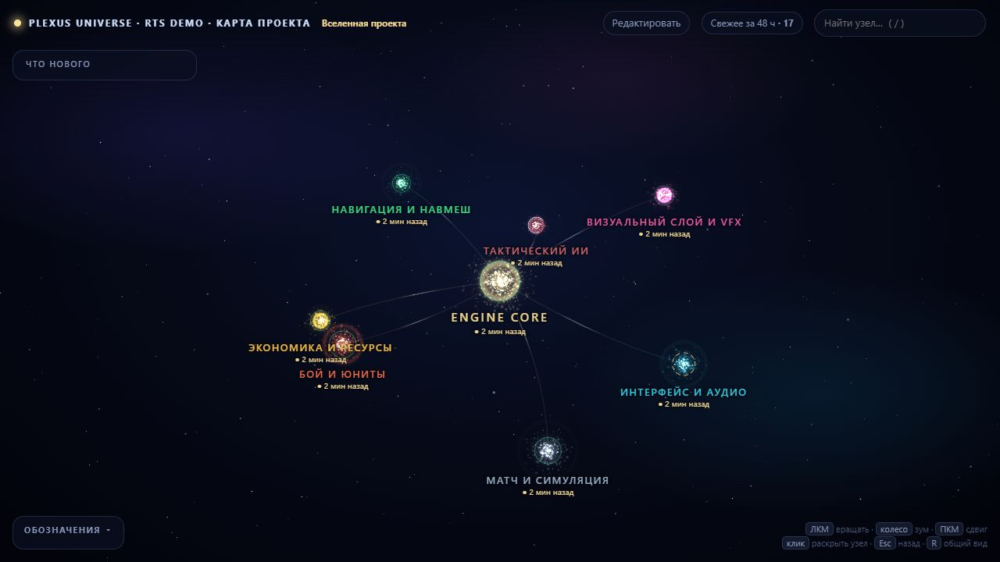

# Plexus Universe

**A living project map for game developers and AI agents.**

[Try the live demo](https://craftimru.github.io/plexus-universe/) · [Русский](README.md) · [CLI reference](references/agent-api.md) · [Skill installation](references/installation.md) · [MCP setup](references/mcp.md)

[](https://craftimru.github.io/plexus-universe/)

*An illustrative RTS project. Click the screenshot to explore the live graph in your browser.*

A game gradually grows its own universe: combat, economy, UI, units, art, notes, and systems that have not been built yet. The files are there. The reasoning that connects them is harder to keep in view, especially when a human and an AI coding agent share the work.

Plexus Universe puts that picture on a local 3D map. Open a branch, inspect a subsystem, follow its dependencies, and find the source files, tests, or references behind it. The solar-system layout makes the hierarchy visible: project → sections → systems → entities.

The same map has a smaller interface for agents. A CLI or MCP query returns just the relevant nodes and connections. The agent can find context, work on the code, then update the affected part of the map through validated commands. There is no fixed percentage claim about token savings; the practical idea is to send small selections instead of the whole index.

## What is included

- Offline Three.js viewer with search, node cards, dependency links, development status, and recent-change indicators.
- Browser graph editor for nodes, hierarchy, links, file paths, and drag-and-drop image thumbnails.
- Agent CLI: `search`, `node`, `context`, `path`, validated node/link updates, batch patches, health checks, and advisory bootstrap.
- Optional stdio MCP server, read-only by default; write tools can be enabled explicitly.
- Human-edit tracking: agents must inspect the change, explain to the user how they will handle it, and record an acknowledgement note before changing an affected node.
- Node locks, review flags, change history, revision conflict checks, and rollback on build failure.
- Installable `SKILL.md` package with project-map discovery and initialization.

The map is curated by people and agents. It describes design intent as well as implemented systems. Folder and `@orbit:` marker imports suggest a starting structure; they do not infer the architecture for you.

It is engine-independent and can describe Godot, Unity, Unreal Engine, or custom engine projects through paths and explicit relationships. There are no engine-specific code or scene parsers yet.

## Try it

Open `index.html` to view the included RTS example. Three.js is bundled, so the viewer needs no internet connection or web server.

With Python 3.9+:

```sh
python -X utf8 edit_graph.py
```

On Windows, `edit_graph.bat` starts the editor. The “Редактировать” button in the viewer switches to editing when the local editor server is running on the same origin; a directly opened HTML file shows launch instructions.

```sh
python -X utf8 graph_agent.py search "damage"
python -X utf8 graph_agent.py node sys_damage_model
python -X utf8 graph_agent.py context sys_damage_model --depth 1
```

Queries return compact JSON, limited to 6,000 characters by default. CLI writes support dry runs, revision checks, batch changes, and explicit `--rebuild`. The shipped RTS graph is illustrative, not a playable game or an analysis of your own project.

## Use it in your project

Install the skill for Codex from the cloned repository:

```sh
python -X utf8 scripts/skill_bundle.py install
```

Invoke `$plexus-universe` and point it at the game project. The skill locates the project's own map rather than using the bundled demo. It can initialize a new map when requested:

```sh
python -X utf8 scripts/project_graph.py init --project /path/to/game
```

For an existing map, update from a fresh checkout without replacing its working configuration, edits, history, or images:

```sh
python -X utf8 scripts/project_graph.py update --map /path/to/game/tools/project_graph
```

For MCP, Python 3.10+ and the optional SDK are required:

```sh
python -m pip install -r requirements-mcp.txt
```

See [MCP setup](references/mcp.md). The CLI and editor do not require the SDK.

## A few honest limits

The map stays useful when its owners maintain it. Missing nodes do not prove code is absent, and a test path does not mean the test passed. There is no semantic search, complete source analysis, or simultaneous multi-user editing. Acknowledgement checks work through the CLI/MCP APIs; direct file edits can bypass them.

Content changes, source/test files, and images contribute to freshness. Changes propagate to every ancestor, while rebuilds and acknowledgement notes do not make the graph fresh again. Keep the local freshness cache when updating an existing map.

## Tests

```sh
python -X utf8 -m unittest discover -s tests -v
```

GitHub Actions checks the core on Windows and Linux with Python 3.9/3.12, plus real MCP stdio reads and writes in separate jobs.
