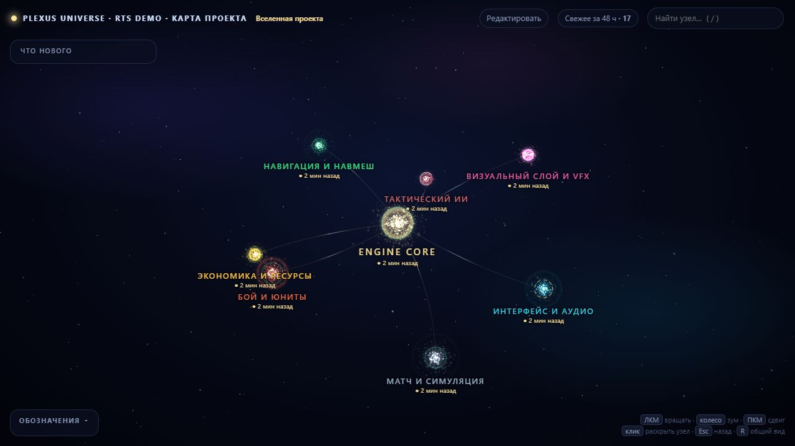

# Plexus Universe

**Живая карта игрового проекта для человека и ИИ-агентов.**

[Открыть живое демо](https://craftimru.github.io/plexus-universe/) · [English](README.en.md) · [Установка навыка](references/installation.md) · [CLI](references/agent-api.md) · [MCP](references/mcp.md)

[](https://craftimru.github.io/plexus-universe/)

*На скриншоте пример RTS. Нажмите на картинку, чтобы открыть карту, повращать её и посмотреть, как устроены узлы.*

В игре постепенно накапливается отдельная вселенная: боевые системы, экономика, интерфейс, юниты, арты, заметки и планы. Всё это связано между собой, но в папках эти связи почти не видны. А когда к разработке подключается ИИ-агент, приходится ещё и каждый раз объяснять, где что лежит и какие решения уже приняты.

Plexus Universe появился из желания собрать эту картину в одном месте. Открываешь карту — видишь основные системы, раскрываешь нужную ветку, читаешь описание, переходишь к связанным файлам и референсам. Проект в центре, вокруг — разделы, подсистемы и отдельные сущности. Космический вид здесь просто оказался приятным способом показать такую структуру.

Для агента у той же карты есть другой вход: короткие запросы через CLI или MCP. Найти систему, получить её файлы и соседние связи, выполнить задачу, обновить изменившуюся часть карты. Весь граф не нужно снова отправлять в контекст.

Мне особенно важен момент, когда человек поправляет описание или меняет арт. Такие правки получают отдельную отметку. Агент должен прочитать, что изменилось, сказать пользователю, как он это учтёт, и сохранить своё пояснение. Хочется, чтобы карта помогала договариваться о проекте, а не становилась ещё одним документом, который постоянно кто-то перетирает.

## Что уже можно делать

- Исследовать архитектуру игры на 3D-карте: от проекта целиком до конкретной сущности.
- Редактировать узлы и связи в браузере, добавлять изображения перетаскиванием, выбирать обложки и подписывать референсы.
- Видеть недавние изменения: новая дата сущности поднимается через подсистему и раздел до корня проекта.
- Давать агенту ровно нужную часть контекста и обновлять карту проверяемыми командами после задачи.
- Проверять пропавшие пути, находить файлы без привязки к карте и получать предложения по начальной структуре.
- Работать локально. Просмотрщику не нужен сервер; редактор и CLI используют Python, MCP подключается отдельно.

Карту наполняют человек и агент. Здесь можно описать и работающую систему, и ещё не реализованную идею. Импорт из папок помогает начать, но ответственность модулей и смысл связей всё равно нужно сформулировать. Именно это описание потом и становится полезным контекстом.

Инструмент не зависит от игрового движка: можно описывать проекты на Godot, Unity, Unreal Engine или собственном движке. Специального разбора их сцен и исходников пока нет — карта работает с указанными вами путями и связями.

> **For English-speaking developers:** Plexus Universe is a local-first 3D project map and knowledge graph for game development with AI agents. It includes a visual editor, bounded CLI and MCP context queries, validated graph updates, and human-edit awareness. [Read the English overview →](README.en.md)

## Запуск

Для просмотра откройте `index.html`. Three.js r128 и готовый пример включены в репозиторий; интернет и сервер не нужны.

Для редактора, сборки и CLI нужен Python 3.9+:

```sh
python -X utf8 edit_graph.py
```

На Windows можно запустить `edit_graph.bat`. Откроется [локальный редактор](http://127.0.0.1:8765/editor.html); остановка сервера — Ctrl+C. Другой порт задаётся через `--port 8767`.

Кнопка «Редактировать» в `index.html` переключает текущее окно в редактор с выбранным узлом, если страница открыта через его сервер. При открытии HTML-файла напрямую она показывает инструкцию запуска и ссылку на уже запущенный редактор. Сам браузер не запускает Python или BAT-файлы.

Для пересборки без редактора:

```sh
python -X utf8 build_graph.py
```

`open_graph.bat` пересобирает карту и открывает просмотрщик. Git используется для дат изменений, а без него — время изменения файлов. Pillow нужен только для обработки изображений из Python-конфигурации; загрузка через редактор обходится без него.

В комплекте — условная RTS с боем, экономикой, навигацией и ИИ. Узлы ссылаются на файлы инструмента для демонстрации. Это пример карты, а не реализованная игра.

## Как работать вместе

1. Перед задачей агент находит нужную систему через `search`, `node`, `context` или `path`.
2. Читает её исходники и тесты, выполняет задачу.
3. Если поменялись пути, ответственность, статус или зависимости — обновляет соответствующие узлы и связи через CLI/MCP.
4. Пересобирает данные и проверяет затронутую часть карты. Человек видит результат в просмотрщике и может поправить его в редакторе.

Короткие запросы позволяют не передавать весь индекс в контекст модели. По умолчанию ответ ограничен 6 000 символов; это лимит объёма, а не точный подсчёт токенов. Фиксированный процент экономии не заявляется.

```sh
python -X utf8 graph_agent.py search "урон"
python -X utf8 graph_agent.py node sys_damage_model
python -X utf8 graph_agent.py context sys_damage_model --depth 1 --direction both
python -X utf8 graph_agent.py path "src/combat/damage.gd"

python -X utf8 graph_agent.py update-node sys_damage_model --human "Обрабатывает попадания и рассчитывает урон" --rebuild
python -X utf8 graph_agent.py set-status sys_ai_commander wip --rebuild
```

Все команды запускаются из папки инструмента или по полному пути к скрипту. `--root /path/to/project_graph` перед командой выбирает другую папку инструмента. Список команд, формат пакетных правок и ответы описаны в [справочнике CLI](references/agent-api.md).

## Пользовательские правки не теряются молча

Когда пользователь сохраняет изменения в редакторе, затронутые узлы получают `human_edit`: дату, список изменённых полей и уникальный токен. Это касается текста, связей, путей, артов и подписей изображений. Агент видит `human_pending` в поиске и подробности в `node`.

Агент сначала изучает сравнение «было → стало» и сообщает пользователю, что увидел и как учтёт изменения. Только после этого он записывает ознакомление с пояснением. Команды агента отклоняют изменение такого узла или его связей до этого шага:

```sh
python -X utf8 graph_agent.py node sys_damage_model
python -X utf8 graph_agent.py human-changes sys_damage_model
python -X utf8 graph_agent.py acknowledge-node sys_damage_model --token TOKEN_FROM_NODE --note "Уточнение назначения прочитано; сохраняю формулировку и учту её в задаче" --rebuild
```

Непрочитанные изменения накапливаются между сохранениями, чтобы мелкая следующая правка не скрыла предыдущую. Технический токен защищает от подтверждения устаревшей версии; пользователю не нужно управлять им. Агент должен объяснить, что принял как актуальное, что учтёт в работе, а что требует уточнения. Новая человеческая правка снова требует ознакомления. Подтверждение не означает разрешения переписать пользовательский текст или заменить картинку: инструкция агента требует сохранять эти изменения, если задача не предполагает их правку.

Отдельно есть `locked` — запрет изменения узла агентом, и `needs_review` — просьба проверить узел. Человек управляет этими флагами в редакторе. Ознакомление с правкой не снимает `locked`. Эти проверки действуют через CLI/MCP; они не защищают от прямого редактирования файлов в обход инструмента.

## Проверка актуальности и начало новой карты

```sh
# Проверить существование объявленных путей, связи и отметки проверки
python -X utf8 graph_agent.py health

# Дополнительно поискать непривязанные исходники в выбранной папке
python -X utf8 graph_agent.py health --scope src

# Предложить узлы и пути по файлам и маркерам; ничего не сохранять
python -X utf8 graph_agent.py bootstrap --scope src --parent pillar_combat
```

`health` проверяет последний собранный граф и предупреждает, когда нужна пересборка. Сканирование непривязанных файлов выполняется только при явном `--scope`; по умолчанию обрабатывается до 2 000 подходящих файлов. Старая дата коммита не считается признаком неисправности.

Маркеры вида `# @orbit: sys_damage_model` связывают файл с узлом. Для неизвестного ID и указанного `--parent` импорт предложит новый узел со статусом `idea` и `needs_review`. Без маркеров он может предложить группировку непривязанных файлов по папкам. Названия, ответственность и зависимости нужно уточнить; автоматически архитектура не угадывается.

## Редактор и сохранение

Выберите узел на карте или в списке. Можно изменить описание, статус, родителя, уровень, пути и связи, добавить узел или удалить узел без потомков. Изображения добавляются перетаскиванием или выбором файла; можно назначить обложку и подписи. Браузер сохраняет JPEG-миниатюры до 720 × 720 в `art/`.

«Сохранить граф» обновляет просмотрщик и индекс агента. Правки CLI/MCP и редактора используют один слой валидации: проверяются родители, уровни, ссылки и конфликт версии. Пакет правок применяется целиком. Перед заменой снимка сохраняется `graph_edit.json.bak`; при ошибке сборки восстанавливаются снимок, журнал и файлы данных.

Правки сохраняются в `graph_edit.json` — полном снимке описания поверх `graph_content.py`. Последующие изменения перекрытых настроек Python не попадут в карту, пока используется снимок. `PROJECT_ROOT` всегда остаётся в Python-конфигурации. Подробнее: [настройка карты](references/configuration.md).

Кто и когда менял карту и какие поля затронуты, записывается в `graph_history.jsonl`:

```sh
python -X utf8 graph_agent.py history sys_damage_model
```

Журнал — история операций с полями, не полная система восстановления версий. Снимок и арты можно хранить в Git вместе с кодом. Одновременное редактирование разрешается проверкой версии и блокировкой записи; автоматического слияния и многопользовательской синхронизации нет. Прерванный процесс может оставить `graph_write.lock`: удаляйте его только убедившись, что запись больше не выполняется.

## Подключение агента

Репозиторий оформлен как устанавливаемый навык с `SKILL.md`, метаданными интерфейса и всеми локальными инструментами. Установка в каталог навыков Codex:

```sh
python -X utf8 scripts/skill_bundle.py install
```

Вызывайте его как `$plexus-universe`. Навык находит карту текущего проекта, учитывает пользовательские правки и обновляет граф после задачи. Если пользователь просит создать карту, `scripts/project_graph.py init --project PATH` создаёт отдельную карту с одним корневым узлом вместо копирования RTS-демо.

Установка для других агентов и сборка переносимого `.skill`-архива описаны в [инструкции установки](references/installation.md). Если skills не поддерживаются, добавьте в `AGENTS.md` игрового проекта:

```markdown
Для навигации и обновления карты проекта используй tools/project_graph/graph_agent.py
и инструкцию tools/project_graph/SKILL.md. Читай нужные узлы вместо всего индекса.
После задачи обновляй затронутые узлы и связи и пересобирай карту.
Перед изменением узла ознакомься с human_edit; сохраняй пользовательские правки.
```

Для MCP нужен Python 3.10+ и дополнительный SDK. Сервер работает локально через stdio; по умолчанию предоставляет только чтение. Инструкции подключения и включения записи: [MCP](references/mcp.md).

## Управление картой

ЛКМ — вращение, колесо — масштаб, ПКМ или Shift + ЛКМ — сдвиг. Клик выбирает узел, кнопка в карточке раскрывает потомков, `/` открывает поиск, `Esc` закрывает карточку или поднимает на уровень, `R` возвращает общий вид.

Статусы: `idea`, `art`, `proto`, `wip`, `live`, `polished`, `shelved`. Легенда позволяет приглушить выбранные статусы, а фильтр свежести — выделить недавние изменения. Статусы и тесты являются описанием, а не результатом автоматической проверки кода.

Время изменения учитывает описание узла, статус, связи, исходники, тесты и изображения. Новая дата листового узла поднимается по всей цепочке родителей до корня; соседние ветки остаются прежними. Простая пересборка и ознакомление агента с человеческими правками не делают узлы «свежими» заново. `at` — время собственных изменений, `agg_at` — максимум по узлу и его потомкам; подпись на карте использует второе.

Для прямых правок Python/JSON сборщик сравнивает содержимое узлов с локальным кешем `data/freshness.json`. Кеш сохраняйте при обновлении инструмента. При первом запуске старой карты точные прошлые даты удаётся восстановить только из имеющихся отметок и журнала; отсутствующую историю программа не выдумывает. После внешней правки выполните сборку и обновите страницу.

Для обновления существующей карты из свежей копии репозитория используйте `scripts/project_graph.py update --map PATH_TO_MAP`. Команда обновляет файлы инструмента, сохраняя конфигурацию, рабочий JSON, историю, арты и кеш, затем пересобирает данные. Подробности — в [инструкции установки](references/installation.md).

## Проверки и ограничения

```sh
python -X utf8 -m unittest discover -s tests -v
```

GitHub Actions запускает основные тесты на Windows/Linux с Python 3.9 и 3.12; MCP проверяется отдельно с установленным SDK. Визуальная часть не зависит от MCP.

Карта полезна, пока человек и агент поддерживают её актуальность. Отсутствие узла не доказывает отсутствие кода, а наличие пути к тесту — его успешное прохождение. Семантического поиска, полного анализа исходников и автоматического подтверждения архитектуры нет. Если карта не покрывает задачу, агент должен искать в коде.
